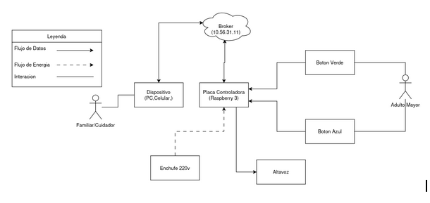

# Asistente para Mayores

Sistema que mejora la comunicación entre una persona mayor y un familiar cuidador. Un dispositivo Raspberry Pi dentro de una cajita blanca con dos pulsadores (azul y verde) reproduce por parlante los mensajes y recordatorios enviados desde una aplicación móvil, y permite a la persona mayor pedir ayuda con un botón SOS.



`foto.png`

## Tabla de contenidos

- [De qué trata el proyecto](#de-qué-trata-el-proyecto)
- [Arquitectura](#arquitectura)
- [Caso de uso](#caso-de-uso)
- [Raspberry Pi y parlante](#raspberry-pi-y-parlante)
- [MQTT y broker](#mqtt-y-broker)
- [Botones](#botones)
- [Provisioning y habilitación](#provisioning-y-habilitación)
- [Deploy](#deploy)
- [Análisis de posibles fallas](#análisis-de-posibles-fallas)
- [Estado del proyecto](#estado-del-proyecto)
- [Repositorios](#repositorios)

## De qué trata el proyecto

El proyecto conecta a una persona mayor con su familiar mediante un dispositivo Raspberry Pi alojado en una cajita blanca con dos pulsadores:

| Botón | Función |
|-------|---------|
| Azul | Envía un mensaje de **SOS** al cuidador, indicando la hora. |
| Verde | **Detiene** la reproducción del mensaje que llegó desde la aplicación (se reproduce en bucle hasta que se presiona). |

## Arquitectura

El sistema se compone de tres partes:

1. **Aplicación móvil** (Expo Go): usada por el familiar para iniciar sesión, enviar mensajes y agendar recordatorios.
2. **Servidor Debian 13**: aloja una máquina virtual donde se instalan los servicios, entre ellos el broker MQTT.
3. **Raspberry Pi 3** con Mosquitto: el dispositivo que tiene la persona mayor y que reproduce los mensajes.

```
[App Expo Go] --> [Broker MQTT (Mosquitto)] --> [Raspberry Pi + parlante]
                          ^                              |
                          |------ SOS / ACK -------------|
```

## Caso de uso

### Lado del cuidador (familiar)

1. El familiar inicia sesión con su usuario y contraseña.
2. Se suscribe al topic de mensajes, desde donde puede escribir un mensaje y enviarlo de inmediato a la Raspberry o programarlo con fecha y hora.
3. Agenda un recordatorio con fecha, hora y la pastilla que debe tomar como mensaje.
4. El mensaje y la hora se guardan en la base de datos hasta que el código que verifica el tiempo detecta la hora programada y envía el mensaje por MQTT.
5. Al llegar la hora, el mensaje se reproduce por el parlante.
6. El mensaje se repite hasta que se presiona el botón de detención, que publica en un topic que corta la reproducción.

### Lado del adulto/a mayor

- Puede presionar dos botones: uno detiene la reproducción del mensaje y el otro envía un SOS.
- El SOS se publica por MQTT y le llega al cuidador como notificación en la barra de notificaciones del celular. Con eso el cuidador puede llamar a la policía o a una ambulancia desde su teléfono.

> Este caso de uso describe cómo se espera que funcione el proyecto completo. Algunas partes (entrega por MQTT controlada por el estado activo y notificación de SOS) todavía requieren integración y pruebas. Ver [Estado del proyecto](#estado-del-proyecto).

## Raspberry Pi y parlante

La Raspberry es el "cerebro" del parlante. Ejecuta un programa en Python que espera mensajes y, cuando recibe un texto, lo dice en voz alta con `espeak-ng`.

- Si llegan varios mensajes, se guardan en una **cola en memoria**.
- El mensaje que está sonando se repite hasta que se lo detiene.

## MQTT y broker

MQTT es el protocolo usado para enviar mensajes entre equipos. El **broker** (Mosquitto) actúa como intermediario: recibe los mensajes y se los entrega a los dispositivos suscriptos al tema correspondiente.

Temas usados actualmente en el código de la Raspberry (de prueba):

| Tema | Uso |
|------|-----|
| `prueba` | Mensaje a reproducir |
| `prueba/parar` | Detener la reproducción |
| `prueba/sos` | Señal de SOS |

## Botones

El programa contempla un botón para detener lo que se está reproduciendo y otro para enviar la señal SOS por MQTT. Esto está implementado en el código.

Pendiente: confirmar en la Raspberry real que los botones estén conectados a los pines correctos y probar el aviso SOS de punta a punta.

## Provisioning y habilitación

Para preparar cada equipo se configura la conexión al broker y se identifica el parlante con un ID, por ejemplo `CERCA-001`.

- La vinculación mediante código de confirmación ya está hecha.
- La configuración de red y credenciales del dispositivo sigue siendo **manual**. No está demostrado que la Raspberry se configure sola desde la app.

Al quedar habilitado un equipo, se registra su estado como activo.

## Deploy

Servicios utilizados:

| Componente | Servicio |
|------------|----------|
| Aplicación | Expo Go |
| Servidor | Debian 13 |
| Dispositivo | Raspberry Pi 3 con Mosquitto |
| Virtualización | Máquina virtual donde se instalan los servicios y se usa el broker |

## Conexión de los botones
Cada botón une un pin GPIO con GND:

| Botón | GPIO (BCM) | Pin físico | Otro extremo |
|-------|-----------|------------|--------------|
| SOS   | 17        | 11         | GND (pin 9)  |
| Parar | 27        | 13         | GND (pin 14) |

Si usás otros pines, cambialos en `config.py`.

## Análisis de posibles fallas

- **Corte de luz:** la Raspberry deja de funcionar, por lo que no puede enviar ni recibir información ni reproducir audio.
- **Reinicio del programa:** la cola de audio está en memoria, por lo que se pierde.

### To Do's
- [x] Programa en Python en la Raspberry: recibe texto y lo reproduce con `espeak-ng`.
- [x] Cola de mensajes en memoria y repetición del mensaje actual hasta detenerlo.
- [x] Lógica de botones para detener y para SOS en el código.
- [x] Vinculación del equipo con código de confirmación.
- [x] Registro del estado activo al habilitar el equipo.

- [ ] Manejo de recordatorios con fecha y hora en la Raspberry, con guardado en **memoria no volátil**.
- [ ] Definir cómo la placa sabe si es la hora de un recordatorio (sincronización de hora, por ejemplo con servidor NTP).
- [ ] Que la Raspberry consulte su estado activo y que el envío por MQTT se integre con la habilitación (enviar solo al equipo correcto cuando esté activo).
- [ ] Configurar dirección, puerto y credenciales MQTT mediante variables de entorno.
- [ ] Definir temas MQTT por cada Raspberry y hacer coincidir el tema del emisor con el de la placa.
- [ ] Configurar permisos y credenciales MQTT por equipo.
- [ ] Verificar el cableado y los pines de los botones en la Raspberry real.
- [ ] Probar el recorrido completo: recibir mensaje, reproducirlo y detenerlo con el botón.
- [ ] Probar la señal SOS de punta a punta, incluida la notificación en el celular.
- [ ] Probar el comportamiento ante corte de luz o de conexión.
- [ ] Completar el diagrama de bloques (leyenda y todos los roles de usuario).

## Repositorios

- Raspberry: <https://github.com/solp3rez/AsistententeParaMayores-sebas.git>
- Aplicación: <https://github.com/solp3rez/App-final-Asistenteparagentemayor.git>